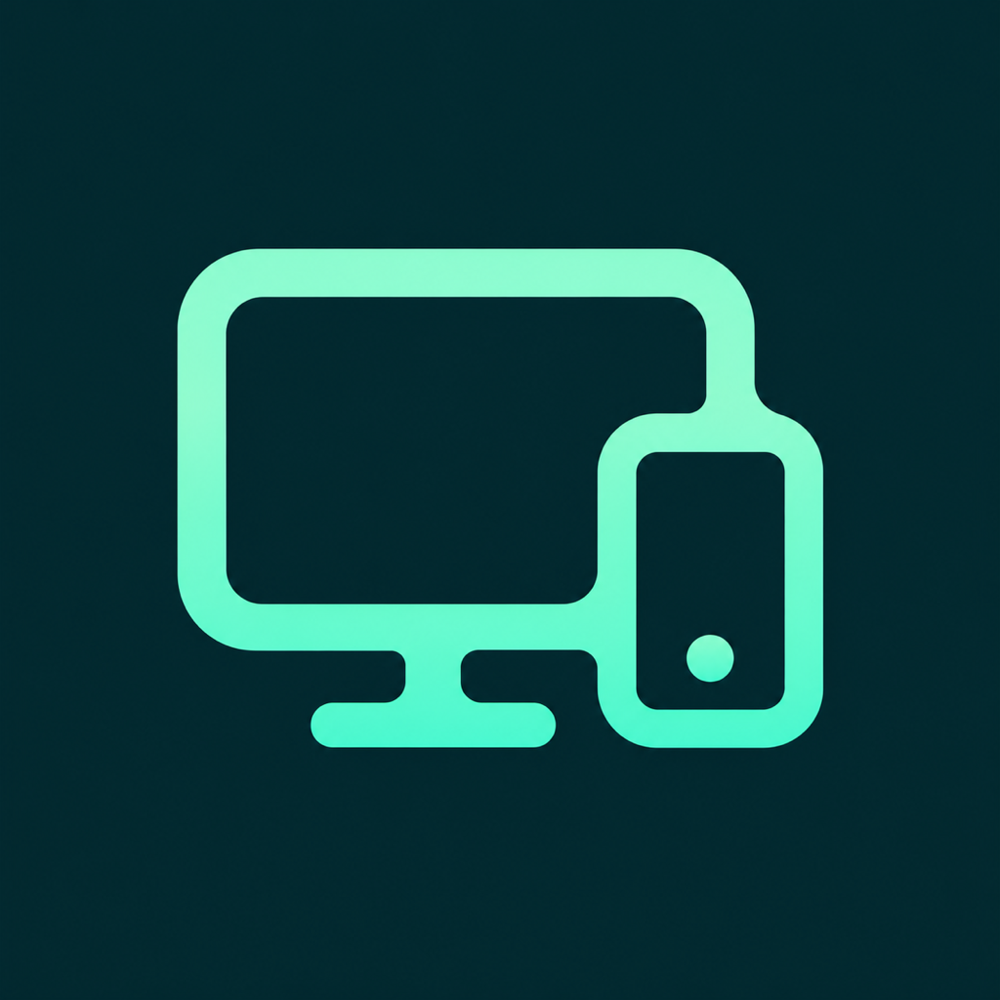

<p align="center"></p>
<h1 align="center">Mac2Phone</h1>
<p align="center"><strong>Your screens. Closer together.</strong><br>Open-source screen sharing and remote control, directly over your local network.</p>
<p align="center">
  <a href="https://kiashamlou.github.io/mac2phone/"><strong>Explore the website</strong></a> ·
  <a href="https://github.com/KiaShamlou/mac2phone/releases">Desktop downloads</a> ·
  <a href="#build-and-run">Build from source</a> ·
  <a href="CONTRIBUTING.md">Contribute</a>
</p>
<p align="center"><a href="LICENSE">MIT licensed</a> · Local network · No cloud account<br><strong>Windows: Beta &nbsp; | &nbsp; Android: Beta</strong></p>

---

Mac2Phone started with a simple idea: use your Mac from your iPhone or iPad, with a touch-first experience rather than a tiny desktop cursor. It is growing into a local-network bridge between phones and computers.

Find nearby running apps, send a connection request, compare the code, and let the other person accept before sharing. View a screen, enable keyboard and pointer control where supported, and opt into sound. The native Mac host also provides cursor-free Touch mode and hardware video encoding.

### Pick your platform

| Platform | Status | What to expect |
| --- | --- | --- |
| **macOS** | Development preview | Native screen-sharing host and a separate desktop viewer; the unified app is still in progress. |
| **iPhone & iPad** | Development preview | Native viewing and Mac touch control; device broadcasting is view-only. Build with Xcode. |
| **Windows** | **Beta** | Desktop viewing, selected-screen sharing, keyboard/mouse and optional system sound. Extract the entire portable ZIP. |
| **Android** | **Beta** | Native viewing and consent-based broadcasting, with optional Accessibility control. Build from source. |
| **Linux** | Experimental | Desktop source and packaging; X11 input, Wayland view-only. Physical testing is still needed. |
| **Apple Watch** | Companion preview | Keys, scrolling and text through a connected foreground iPhone—not full screen mirroring. |

**Windows and Android are beta software.** Expect rough edges, device-specific behavior and performance changes. No platform is being presented as a stable 1.0 release. See the [capability matrix](docs/CROSS_PLATFORM.md) before choosing a setup, and include both app versions and diagnostics when [reporting a bug](https://github.com/KiaShamlou/mac2phone/issues/new?template=bug_report.md).

> **Protocol v2 development preview.** Connections now require a private pairing link and use encrypted TLS for screen, audio and input. Update both Apple apps together: old clients and the unauthenticated browser viewer no longer connect. This is an early LAN-only implementation, not a security-audited release. See [SECURITY.md](SECURITY.md).

## Nearby connection requests

Updated apps list **Nearby devices** on your LAN. Select a device, compare the verification code, and wait for its **Accept & share** approval. Grants are one-use and expire after 60 seconds; no screen or control is shared merely because a device is discovered. System capture/input prompts still apply. See [the platform guide](docs/CROSS_PLATFORM.md#nearby-devices-and-approval) for mobile foreground behavior and platform differences. Both devices need the updated build; earlier release archives do not include this change.

## What it does

- Native HEVC/H.264 video over paired TLS; JPEG interoperability across desktop, Android and iOS broadcasts.
- **Touch mode:** cursor-free video, local touch feedback, tap to click, swipe to scroll, hold to drag, and window-aware movement/resizing.
- Pointer and relative trackpad modes, plus keyboard shortcuts and text input.
- Optional Mac audio through the included virtual audio device.
- Bonjour availability hints; explicit pairing links containing a LAN address.
- Optional display fitting, resolution recovery, and a menu-bar emergency stop.
- An iOS-inspired Mac workspace, native iPhone/iPad connection sheets, gesture guide, and selectable stream presets.
- Electron desktop viewing and hosting: selected-screen capture, optional system audio and opt-in Windows/X11 input.
- Desktop-to-desktop WebRTC video, automatic fullscreen, aligned pointer coordinates and live quality/FPS controls; older peers retain JPEG compatibility. See [realtime transport](docs/REALTIME.md).
- Android viewing, consent-based screen/audio broadcasting and optional Accessibility-based touch/text control.
- iPhone/iPad ReplayKit view-only broadcasting and an Apple Watch companion for keys, scroll and text.
- These are development previews; Linux and physical cross-platform behavior still need device testing.

This translates gestures into macOS mouse, scroll, keyboard, and Accessibility actions. It does **not** turn macOS into a native multitouch OS. Pinch uses Command-scroll; application support varies. Display rotation uses a private API and is experimental.

## Build and run

### Requirements

- macOS 14 or later; iOS/iPadOS 17 or later.
- Xcode 16 or later with the appropriate platform SDKs (the project uses synchronized folders).
- The devices on the same Wi-Fi or iPhone Personal Hotspot.
- Screen Recording permission on the Mac. Accessibility permission is needed for control.
- Your own Apple signing team for installation on a physical iPhone/iPad.

### Mac

```sh
swift build
swift run mac2phone --no-speak
```

For a persistent menu-bar app that starts at login:

```sh
Scripts/install.sh
```

The installer builds the app, signs with an available development identity (or ad-hoc), installs it, and registers a LaunchAgent. Set `SIGNING_IDENTITY` to choose your certificate. Ad-hoc builds may need privacy permissions reapproved after updates.

Click the **Mac2Phone menu-bar icon** for quick controls, then **Open Mac2Phone** for the native Overview, Display & power, and Permissions screens. Right-click the icon for the classic quick-action menu. The workspace opens automatically the first time you run this version. `⌃⌥⌘M` toggles mirroring; `⌃⌥⌘I` speaks the address. Use `--no-control` for a view-only server. `swift run mac2phone --help` lists the options.

### iPhone and iPad

1. Open `iOS/Mac2Phone.xcodeproj` in Xcode.
2. Configure signing for the app, Broadcast extension and Watch companion. Enable the same App Group for the iOS app and extension; see the [Apple setup guide](docs/CROSS_PLATFORM.md#iphone-ipad-and-watch).
3. Build the `Mac2Phone` scheme for your device.
4. Allow Local Network access. On the Mac, click **Copy Pairing Link**; on iPhone, tap **Pair a device** and paste it.

Or explicitly install onto a device using your team:

```sh
DEVELOPMENT_TEAM=YOUR_TEAM_ID Scripts/resign-ios.sh YOUR_DEVICE_ID
```

Pairing keys are stored in Keychain on Apple devices. After a successful connection, automatic connection can reuse the last paired Mac on a later launch. Reconnect remains explicit after a network failure.

### Build without signing

```sh
xcodebuild -project iOS/Mac2Phone.xcodeproj -scheme Mac2Phone \
  -sdk iphonesimulator -destination 'generic/platform=iOS Simulator' \
  CODE_SIGNING_ALLOWED=NO build
```

## Desktop and Android previews

Requires Node.js 24+ for development. The Windows build is a portable **folder** containing `Mac2Phone.exe`, not a single-file installer. No Node installation is needed on the target machine after packaging.

```sh
cd desktop
npm ci
npm run setup
npm test
npm start
# On Windows, or to cross-package the Windows x64 folder:
npm run package:windows
```

Keep the **entire** output folder together. Copy a pairing link from the updated Mac app and paste it into the desktop client. Enable **Control** and **Sound** separately. Ctrl shortcuts map to Mac Command by default; the checkbox disables that mapping. The text box supports IME/pasted Unicode. Ordinary key presses and shortcuts are supported; held-key/game input is not implemented yet. Sound requires the existing Mac virtual audio setup below.

Desktop pairing is session-only: it is not saved to disk. Reset Pairing in the Mac dashboard disconnects and revokes **all** paired devices. Copy a fresh link if the Mac's LAN IP changes.

To share a Windows display, expand **Share this computer**, choose a screen, enable the permissions you want, and start. Stop sharing revokes that session's link. Linux capture is experimental; input uses X11 with `xdotool`, while Wayland remains view-only. The Mac desktop app is a separate viewer; use the native Mac host for full input.

**Desktop 0.5.3:** adds automatic recovery after an active video stream stalls or disconnects, saved quality/FPS/fullscreen preferences, and protection against late Control replies. Control and Sound remain session-only. The 0.5.2 streaming improvements include two-way Auto quality (sender **and** viewer pressure), demand-sized capture, a 30/60 FPS target, live session health, Copy diagnostics and Retry realtime. Update both desktop ends for receiver feedback and the FPS selector; older WebRTC peers remain compatible. Approved viewing opens fullscreen: **F11** toggles fullscreen, **F8** reveals controls, and **Shift–Escape** releases control. Auto prioritizes responsiveness; Sharp prioritizes text. FPS targets and resolution caps are not guaranteed achieved rates. See [the realtime design and test notes](docs/REALTIME.md).

**App direction:** the desktop interface is the chosen main UI for a single Mac2Phone app. The native Mac capture, touch mode, display reshaping and power features must be integrated behind that UI—not replaced by the desktop viewer. That native-engine integration is pending; current preview builds still have separate Mac executables. See [the unification decision](docs/UNIFIED_APP.md).

Build the Android debug APK with Java 17 and Android SDK 36:

```sh
android/gradlew -p android testDebugUnitTest assembleDebug
```

On iPhone/iPad, **Share this iPhone / iPad** opens the ReplayKit broadcast flow. **Apple Watch remote** opts into live companion commands through a connected foreground iPhone.

See the [platform capabilities, setup and physical test checklist](docs/CROSS_PLATFORM.md) for exact behavior and remaining validation.

## Touch mode

Choose **Touch** from the mode control. The streamed cursor disappears while Control is on; a local ring follows your finger instead.

| Gesture | Action |
| --- | --- |
| Tap / double-tap | Click / double-click |
| One-finger swipe | Scroll content; drag a title bar to move a window |
| Hold, then move | Drag content, select text, or move a file |
| Hold and release / two-finger tap | Context menu |
| Two-finger swipe | Scroll, including over a window edge or title bar |
| Pinch | Command-scroll zoom in the Mac app, when supported |
| Three-finger swipe | Desktop/Mission Control shortcuts |
| Control off | Local pan and pinch; no touch or keyboard input |

A first interaction with a background window focuses it without acting on its contents. Additional fingers, interruptions, mode changes, and disconnects terminate active gestures. New touches stop scroll momentum. A pause before lifting prevents an unwanted flick.

**Trackpad** mode moves the cursor without holding a mouse button; hold before moving to drag. **Pointer** mode directly maps finger position and dragging. Cursor visibility in those modes follows your settings.

The compact floating toolbar keeps Fit, Control, Mode, Keyboard, and More within reach. On iOS 26 it uses native Liquid Glass; iOS 17–18 use standard materials. Reduce Transparency switches to a solid surface. While typing, the toolbar becomes icon-only, the desktop moves above it, and the shortcut-key strip scrolls horizontally with an always-visible keyboard-dismiss button. More contains window actions, audio, stream quality, the gesture guide, and Disconnect. VoiceOver users keep the toolbar visible.

## Audio and advanced display options

Audio is optional and is not required for screen sharing:

```sh
Scripts/build-audio.sh
sudo Scripts/install-audio.sh
```

Select **Mac2Phone** as the Mac's audio output and grant Microphone access to the companion. The permission covers reading the virtual audio device; the app does not intentionally record a microphone.

Display fitting temporarily selects a suitable Mac display mode. Disconnecting, pausing, or quitting restores the saved mode; startup attempts recovery after an abnormal termination. Keep the dashboard's **Restore display** action available when testing. Physical-device and multiple-display testing is still required.

The optional closed-lid helper changes power behavior and requires a separate deliberate installation. See the scripts and the [original Persian guide](docs/README.fa.md) for background. It is not installed by the standard build.

## Development

```sh
swift test                 # Pure gesture, input-lifecycle, and protocol regressions
Scripts/check.sh --static  # Shell syntax, plist syntax, and protocol-copy parity
Scripts/check.sh           # Static checks, Swift tests, and unsigned iOS build
Scripts/check-cross-platform.sh  # Synthetic Swift ↔ Node TLS integration; no desktop input
```

Tests intercept generated input events; they do not click or type on your desktop. Automated tests complement—not replace—the [device QA matrix](docs/TESTING.md).

| Area | Location |
| --- | --- |
| Mac capture, streaming, input, dashboard | `Sources/mac2phone` |
| iOS transport, touch surface, SwiftUI interface | `iOS/Mac2Phone` |
| Pure touch geometry, velocity, and gesture ownership | `iOS/Mac2Phone/TouchInteraction.swift` |
| Protocol copies, kept identical by checks | Both app directories' `Protocol.swift` |
| Regression tests | `Tests/Mac2PhoneTests` |
| Optional virtual audio driver | `Audio` |
| Experimental desktop client and protocol tests | `desktop` |

See [CONTRIBUTING.md](CONTRIBUTING.md). Before publishing a release, complete the [release checklist](docs/RELEASE_CHECKLIST.md), including pairing review, signing, and device QA. Build outputs, signing material, local verification snapshots, and Xcode user state are excluded by `.gitignore`.

## License

Mac2Phone is licensed under the [MIT License](LICENSE).

## Website and branding

The website is a **React** app with **Lenis** smooth scrolling, **GSAP / ScrollTrigger** choreography, and an adapted **React Bits AnimatedContent** component. Vite builds it into prerendered HTML for GitHub Pages. It stays readable without JavaScript, respects reduced motion, and keeps native touch scrolling.

Requires Node.js 22.12+ (Node 24 is used in CI):

```sh
npm --prefix site ci
npm --prefix site test
npm --prefix site run build
python3 Scripts/check-site.py
npm --prefix site run dev
```

Open `http://localhost:8080`. GitHub Pages publishes only `site/dist`. See [`Branding/README.md`](Branding/README.md) for the logo and [`site/THIRD_PARTY_NOTICES.md`](site/THIRD_PARTY_NOTICES.md) for dependency terms. The repository MIT license covers original Mac2Phone code; third-party components retain their own licenses.
